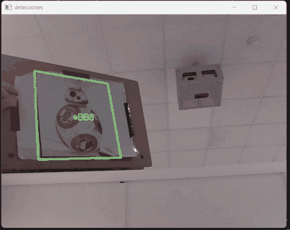
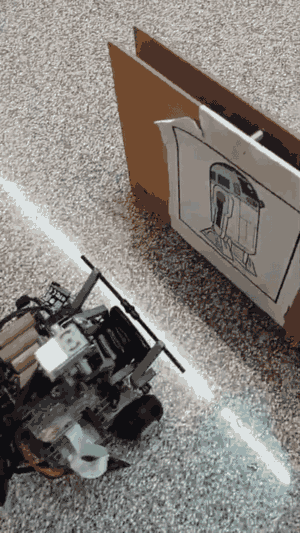
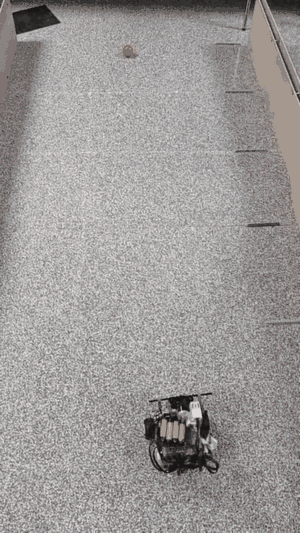
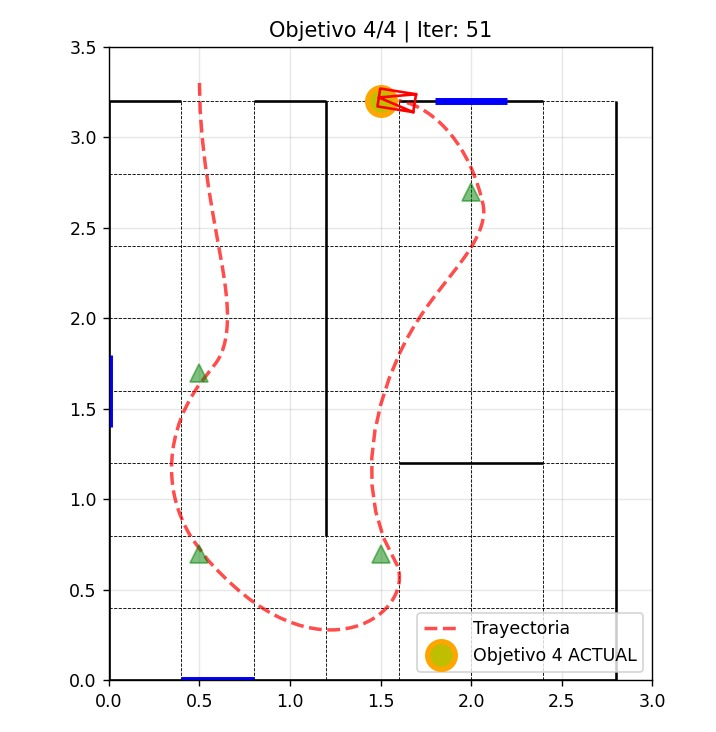
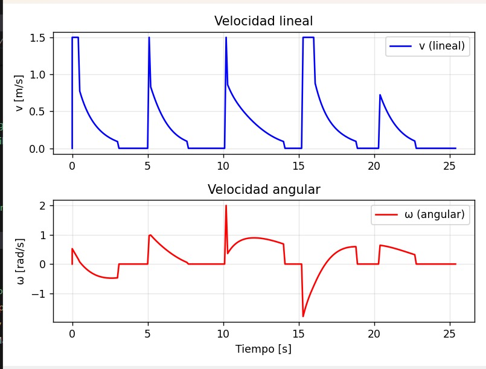
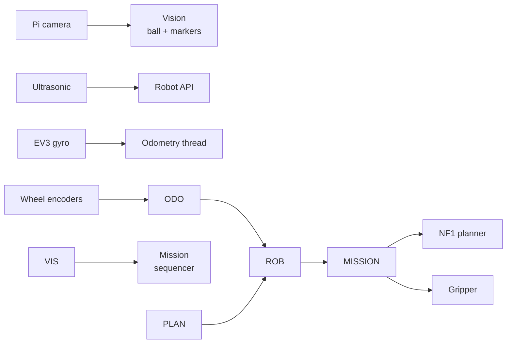
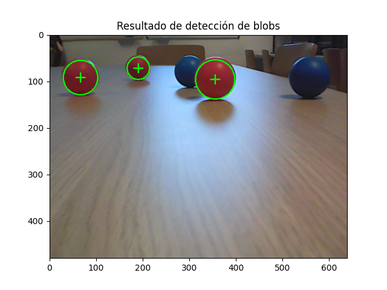

# LEGO Autonomous Robot

**A four-phase autonomous mission on a LEGO Mindstorms / BrickPi3 differential-drive robot.**

The robot drives a timed slalom, plans and follows a path through a maze, tracks and grasps a red ball, then recognises the droid markers at the exit, identifies its assigned one, and drives through that gate.

<p align="center">
  
  <br>
  <em>Real camera feed: ORB keypoints + RANSAC homography tracking the R2-D2 and BB-8 templates in real time. This is the project's own detector, not a simulation render.</em>
</p>

!\[Python](https://img.shields.io/badge/python-3.10%2B-blue)
!\[Tests](https://img.shields.io/badge/tests-20%20unit%20tests-brightgreen)
!\[License](https://img.shields.io/badge/license-academic%20use-blue)

> Project developed for the \*\*Robots Autónomos\*\* course (4th year, GIEA) at the \*\*Escuela de Ingeniería y Arquitectura (EINA), Universidad de Zaragoza\*\*, under the guidance of the course professors. See \[Authors and acknowledgements](#authors-and-acknowledgements).

\---

## What the robot does

|#|Phase|Behaviour|Techniques|
|-|-|-|-|
|1|**Slalom**|Drives two timed arcs through the course and squares up against the side walls.|Differential-drive arcs, ultrasonic distance feedback|
|2|**Maze**|Plans a route to the centre, follows it cell by cell, and replans when the ultrasonic sensor sees an obstacle.|NF1 wavefront, gradient descent, waypoint control, edge-removal replanning|
|3|**Ball**|Searches for the red ball, centres it, approaches until it is close enough, and closes the gripper.|HSV segmentation, contour moments, proportional visual servo|
|4|**Exit**|Recognises the printed R2-D2 / BB-8 markers, chooses the assigned one, approaches it, and crosses the gate.|ORB features, brute-force Hamming matching, RANSAC homography|

The arena is selected automatically from the floor colour: a white floor selects arena A and R2-D2; a black floor selects arena B and BB-8.

## Demo gallery

|Marker following — real robot|Ball tracking — real robot|
|:-:|:-:|
|||
|The physical robot approaches the printed BB-8 marker using the marker follower.|The physical robot tracks the red ball with the HSV blob detector and the area/centroid servo.|

|Navigation trajectory|Velocity commands|
|:-:|:-:|
|||
|Trajectory recorded during the navigation stage (objective 4/4, iteration 51). Green triangles mark intermediate objectives; blue segments are straight runs.|Velocity commands from an earlier navigation run, plotted in m/s. Flat `v≈0` with non-zero `ω` are in-place rotations; the steps come from the waypoint controller.|

The heavy original recordings are not committed; the GIFs above are optimized copies of the authors' own captures.

## Highlights

* **Complete autonomy loop** — sensing, planning, control, manipulation, and vision in one mission.
* **NF1 planner with replanning** — a BFS cost field from the goal, followed by gradient descent; a blocked edge is removed and the field is rebuilt.
* **Gyro-aided odometry** — wheel encoders are integrated with midpoint heading updates and fused with the EV3 gyro when available.
* **Two vision pipelines** — HSV blob tracking for the ball and ORB/RANSAC homographies for the droid markers.
* **Real hardware demos** — the marker-following and ball-tracking GIFs above are recorded on the physical robot, not rendered.
* **Testable core** — kinematics, mapping, and vision are hardware-independent; 20 unit tests cover the math and perception on recorded data.
* **Runs without a robot** — `demo.py` renders a complete NF1 plan from the command line.
* **Simulation-aware** — the coursework simulation process is documented in [`docs/SIMULATION.md`](docs/SIMULATION.md); third-party simulator files are intentionally not vendored.

## Quick start (no hardware)

```bash
python -m pip install -r requirements.txt

python demo.py --map maps/arena\_a.txt --start 1 2 --goal 3 3
```

Output:

```text
Map: arena\_a.txt
  size: 7 x 7 cells
  cell size: 40.0 cm
  start: (1, 2)  goal: (3, 3)
  path: \[(1, 2), (2, 2), (3, 2), (3, 3)]
  cells: 4
  geometric length: 120.0 cm
  NF1 cost at start: 3
Saved figure: .../docs/images/planned\_path\_arena\_a.png
```

Try the other arena:

```bash
python demo.py --map maps/arena\_b.txt --start 5 2 --goal 3 3 \\
  --output docs/images/planned\_path\_arena\_b.png
```

Run the marker detector on the recorded test frame:

```bash
python tools/detect\_markers.py \\
  --image assets/samples/markers\_test.jpg \\
  --output docs/images/marker\_detection.jpg
```

```text
BB8: center=(216.7, 139.6) area=20427px matches=206 inliers=86
R2D2: center=(46.6, 135.7) area=25044px matches=229 inliers=97
sides: {'R2D2': 'left', 'BB8': 'right'}
```

## On the physical robot

Hardware used: Raspberry Pi, BrickPi3, LEGO EV3 large motors, EV3 ultrasonic and gyro sensors, NXT light sensor, Pi camera, and a motorised gripper.

```bash
# On the Raspberry Pi
python -m pip install -r requirements.txt
python -m pip install -r requirements-hardware.txt   # brickpi3

python main.py --arena auto
```

Useful options:

```bash
python main.py --arena a                  # skip floor-colour detection
python main.py --phase maze               # bench-test a single phase
python main.py --camera 1                 # override the camera index
python main.py --artifacts artifacts/run  # save the mission map here
```

> The full mission is the supported end-to-end path (`--phase all`). Single-phase runs assume the robot starts in a sensible pose and are intended for bench testing.

## How it works



|Layer|Module|Responsibility|
|-|-|-|
|Math|`robot/kinematics.py`|Differential-drive forward/inverse kinematics, pose integration, angle wrapping|
|Perception|`robot/vision.py`|HSV ball detector, ORB marker detector, visual-servo controllers|
|Planning|`robot/mapping.py`|Map format, NF1 wavefront, path extraction, replanning, rendering|
|State estimation|`robot/odometry.py`|Background encoder/gyro integration with optional CSV logging|
|Control|`robot/robot.py`|Motor commands, waypoint navigation, obstacle checks, wall alignment, gripper|
|Mission|`robot/mission.py`|Arena selection and the four-phase state machine|
|Hardware|`robot/hardware.py`|Thin adapter over the BrickPi3 API; keeps the rest of the code importable off-robot|

More detail: [`docs/ARCHITECTURE.md`](docs/ARCHITECTURE.md) and [`docs/ALGORITHMS.md`](docs/ALGORITHMS.md).

### The four phases

1. **Slalom.** The track is fixed, so the robot uses calibrated timed arcs rather than localising through it. At the two checkpoints, the ultrasonic sensor measures the distance to the side wall and the robot drives forward/back until it is square.
2. **Maze.** The robot starts from a known cell and pose. `GridMap.plan()` builds a BFS cost field from the goal and walks the gradient from the start. Each waypoint is executed with rotate-then-drive plus heading correction. If the ultrasonic sensor sees an obstacle, the traversed edge is removed from the graph and a new path is planned.
3. **Ball.** The camera stream is converted to HSV; the two red hue ranges are thresholded and cleaned with morphology. The largest contour gives a centroid and an area. The area is a proxy for distance, so a proportional controller drives `v` from the area error and `w` from the horizontal centroid error. When both errors are inside their deadbands, the gripper closes.
4. **Exit.** ORB keypoints are extracted from both reference markers and the camera frame. A brute-force Hamming matcher proposes correspondences; RANSAC fits a homography and retains inliers. The projected template corners give the marker centre and apparent area. The robot follows its assigned marker and drives through the gate.

<p align="center">
  
  <br>
  <em>HSV red-blob detection on the practice table: the red regions are segmented from the background and the largest blob is selected as the ball candidate.</em>
</p>

## Results

|Check|Result|
|-|-|
|Unit tests|**20/20 pass** (`python -m unittest discover -s tests -v`)|
|NF1, arena A: `(1,2) → (3,3)`|4 cells, 120.0 cm, cost 3|
|NF1, arena B: `(5,2) → (3,3)`|4 cells, 120.0 cm, cost 3|
|Marker frame: R2-D2|229 matches, **97 RANSAC inliers**, centre `(46.6, 135.7)`|
|Marker frame: BB-8|206 matches, **86 RANSAC inliers**, centre `(216.7, 139.6)`|
|Marker side classification|R2-D2 left, BB-8 right — correct|

|NF1 plan — arena A|NF1 plan — arena B|
|:-:|:-:|
|||

The unit tests and figures in this repository were run on the hardware-independent modules. The mission was developed for the physical robot and a CoppeliaSim model during the course; this repository is a cleaned refactor. Reproducing it end-to-end requires the BrickPi3 hardware and the arena. See [`docs/VALIDATION.md`](docs/VALIDATION.md) for the exact scope, including a comparison with the explanatory poster (`Cartel\_Robot.pdf`, not included).

## Simulation

The robot was developed with a CoppeliaSim scene and a BrickPi-compatible bridge, so the same control code could run against simulated motors, sensors, and camera before being deployed. The simulator scenes and the course-provided bridge are **not** included here: they are large third-party/course assets and are not needed to understand or reuse the robot code.

The process, the sim-to-real gaps, and how to plug in a simulator through the `Hardware` protocol are described in [`docs/SIMULATION.md`](docs/SIMULATION.md).

## Repository layout

```text
.
├── main.py                     # physical-robot entry point
├── demo.py                     # hardware-free NF1 planning demo
├── robot/
│   ├── config.py               # robot, vision, and arena configuration
│   ├── kinematics.py           # differential-drive math
│   ├── odometry.py             # encoder + gyro odometry thread
│   ├── mapping.py              # NF1 planner and map rendering
│   ├── vision.py               # ball tracking and marker recognition
│   ├── robot.py                # motor/sensor control and waypoints
│   ├── mission.py              # four-phase mission sequencer
│   └── hardware.py             # BrickPi3 adapter
├── maps/
│   ├── arena\_a.txt             # white-floor arena
│   ├── arena\_b.txt             # black-floor arena
│   └── README.md               # map format
├── assets/
│   ├── markers/                # R2-D2 / BB-8 reference images + notice
│   └── samples/                # recorded marker test frame
├── docs/
│   ├── gifs/                   # optimized real-robot demo GIFs
│   ├── images/                 # plans, trajectory, telemetry, blob detection
│   ├── ARCHITECTURE.md
│   ├── ALGORITHMS.md
│   ├── SIMULATION.md
│   └── VALIDATION.md           # tests, poster comparison, limitations
├── tests/                      # 20 unit tests
├── tools/detect\_markers.py     # annotate an image with detections
├── LICENSE.md                  # academic-use terms; code reuse requires permission
└── .github/workflows/tests.yml # CI: tests + offline demos
```

## Design notes

* **Units are explicit.** Distances are cm, angles rad, speeds cm/s and rad/s, map cells 40 cm. The original coursework mixed millimetres, centimetres, and cell indices; the refactor keeps one convention.
* **The odometry loop is a thread.** It is I2C-bound, shares the pose without serialisation, and stops cleanly. The original used a separate process.
* **Failures are typed.** `SensorReadError`, `GoResult`, and `MissionError` distinguish a sensor glitch, a blocked waypoint, and a mission-level failure instead of returning silent `None`s.
* **Vision thresholds are configuration.** Camera resolution, HSV ranges, target areas, ORB feature count, and RANSAC thresholds live in `VisionConfig` so they can be retuned for a different lens or lighting.
* **No vendor or course code is vendored.** The repository contains the project's own control, planning, and perception code plus small marker images, maps, and optimized demo media.

## Authors and acknowledgements

**Authors**

* **Sergio Toro Codo** — author ([@sejotta](https://github.com/sejotta)).
* **Guillén Sainctavit** — author.

**Acknowledgements**

This project was developed for the **Robots Autónomos** course at the **Escuela de Ingeniería y Arquitectura (EINA), Universidad de Zaragoza**. We sincerely thank the course professors for their teaching, continuous correction, and guidance throughout the project. Their supervision made the design, debugging, and final integration possible.

> \*\*Agradecimientos (ES):\*\* Proyecto tutorizado por el profesorado de la asignatura \*\*Robots Autónomos\*\* de la \*\*EINA, Universidad de Zaragoza\*\*. Su corrección y guía hicieron posible este proyecto. Cualquier uso autorizado del código debe reconocer expresamente esta labor.

## License and reuse

This repository is **source-available for study and evaluation**, not an MIT/open-source project. Reading, studying, and referencing the code is free; **reusing, modifying, or redistributing the code requires prior written permission from the authors and, for academic reuse, from the Robots Autónomos teaching team**. Any authorised use must credit the authors and the course teaching team at EINA, Universidad de Zaragoza.

> \*\*Uso (ES):\*\* consulta y estudio libres; la reutilización, modificación o redistribución del código requiere permiso previo por escrito de los autores y, cuando el uso sea académico, del profesorado de \*\*Robots Autónomos\*\* de la \*\*EINA, Universidad de Zaragoza\*\*. Cualquier uso autorizado debe acreditar expresamente esta labor.

See [`LICENSE.md`](LICENSE.md) for the full terms. R2-D2 and BB-8 are used only as non-commercial fiducial markers; see [`assets/markers/NOTICE.md`](assets/markers/NOTICE.md).

