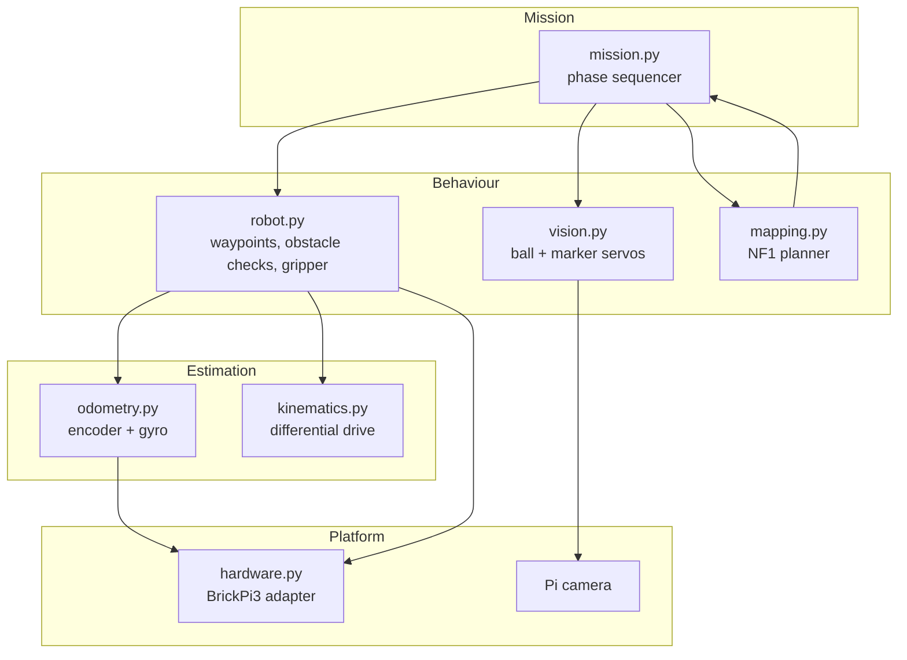
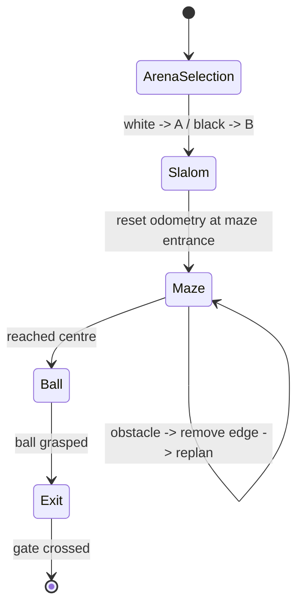

# Architecture

## Context

The robot is a LEGO Mindstorms differential-drive platform driven by a Raspberry Pi through a BrickPi3 board. It has two drive motors, a gripper motor, an EV3 ultrasonic sensor, an EV3 gyro, an NXT light sensor, and a Pi camera. The software has to run on a small ARM board, without a GPU, and keep a stable control loop while the camera and sensors are read.

The design goal is therefore **layered, testable, and explicit about failure**:

- hardware access is isolated behind a small adapter;
- pure math and planning are independent of the robot;
- perception is independent of navigation;
- the mission layer only sequences high-level phases.

## Layered view



## Module responsibilities

| Module | Depends on | Owns |
|--------|------------|------|
| `kinematics.py` | stdlib | Wheel/body speed conversion, encoder increments, midpoint pose integration, angle wrapping |
| `config.py` | `kinematics` | Physical constants, control gains, camera/HSV/ORB settings, arena definitions |
| `mapping.py` | NumPy, Matplotlib (lazy) | Map parsing, connection graph, NF1 wavefront, gradient path, replanning, figures |
| `vision.py` | OpenCV, NumPy | Camera handling, red-ball detection, ORB marker matching, visual-servo commands |
| `odometry.py` | `hardware`, `kinematics` | Background pose estimation, gyro fusion, optional CSV log |
| `robot.py` | `hardware`, `odometry`, `kinematics` | Motor commands, waypoint navigation, ultrasonic checks, wall alignment, gripper |
| `mission.py` | `robot`, `mapping`, `vision`, `config` | Arena selection and the four phases |
| `hardware.py` | `brickpi3` (lazy) | Port mapping, sensor types, error translation |
| `main.py` | all of the above | CLI, logging, safety shutdown |
| `demo.py` | `mapping`, `kinematics` | Hardware-free planning demonstration |

The dependency direction is one-way: `mission` knows about `robot`, `vision`, and `mapping`; none of those import `mission`. This is what makes the planner and vision testable without a BrickPi.

## Execution model

There are two concurrent activities:

1. **Main control thread** — runs the mission, waypoint loops, camera servos, and gripper commands.
2. **Odometry thread** — reads both wheel encoders (and the gyro) every 50 ms, integrates the pose, and writes an optional CSV log.

The pose is a `Pose` value object guarded by a `threading.Lock`. `Odometry.read()` always returns a copy, so callers cannot accidentally mutate shared state. Motor and sensor calls are made through the hardware adapter; the BrickPi library serialises I2C transactions internally.

The original coursework used a `multiprocessing.Process` for odometry. A thread is preferable here because the loop is I/O-bound, the pose is shared without pickling, and shutdown is deterministic on both Linux and Windows. The trade-off is that a blocking I2C call can briefly delay the main loop; at 20 Hz and with short sensor reads this is acceptable.

### Timing

| Loop | Period | Why |
|------|--------|-----|
| Odometry | 50 ms (configurable) | Fast enough for wheel integration; keeps encoder deltas small |
| Waypoint control | 50 ms | Matches odometry; smooth heading correction |
| Ball / marker servo | ~50 ms + camera latency | Camera frame rate is the limiting factor |
| Ultrasonic sampling | 5 samples per check | Median rejects single bad readings |

## Mission state machine



`Mission.run()` executes the phases in order. Each phase returns `None` on success and raises `MissionError` on an unrecoverable condition. `main.py` catches that error, logs it, and always calls `Robot.shutdown()`.

## Failure semantics

| Condition | Detection | Response |
|-----------|-----------|----------|
| Sensor read fails | `SensorReadError` from the adapter | Odometry logs and continues; a single ultrasonic sample is skipped |
| Waypoint sees an obstacle | Median ultrasonic distance below 25 cm | `GoResult.BLOCKED`; the mission backs up and replans |
| Robot stops making progress | Distance to goal grows on 3 consecutive cycles | `GoResult.STUCK`; the mission aborts the phase |
| Waypoint takes too long | 30 s deadline | `GoResult.TIMEOUT`; the mission aborts the phase |
| Ball cannot be found | 20 s camera deadline | `MissionError` |
| Marker cannot be approached | 25 s camera deadline | `MissionError` |
| Ctrl+C | `KeyboardInterrupt` in `main.py` | Stop motors, stop odometry, reset the BrickPi |

A blocked waypoint closes the graph edge between the last reached cell and the next cell. The planner rebuilds the cost field, so the new route cannot use that edge again. If no route exists, the mission stops instead of driving blindly.

## Coordinate frames and units

- **Arena frame**: origin at the bottom-left corner, `x` right, `y` up, `theta` counter-clockwise from `+x`.
- **Robot frame**: `+x` forward, `+y` left; positive `w` is counter-clockwise.
- **Units**: cm for positions and distances, rad for angles, cm/s and rad/s for body speeds, degrees/s at the motor API.
- **Map**: cells are 40 cm; cell `(x, y)` centre is `((x + 0.5) * 40, (y + 0.5) * 40)` cm.

The original code mixed millimetres, centimetres, and cell indices in the same expressions. Keeping the conversion in `GridMap.cell_center_cm()` and in the kinematics module removes most of that ambiguity.

## Hardware abstraction

`robot/hardware.py` defines a `Hardware` protocol and one concrete `BrickPiHardware` implementation. The rest of the code only calls:

```python
set_motor_dps(port, dps)
get_encoder(port)
reset_encoder(port)
set_sensor_type(port, sensor_type)
read_ultrasonic(port)
read_gyro(port)
read_light(port)
reset_all()
```

This boundary is also the simulator seam. A CoppeliaSim adapter only has to implement the same methods; `Robot`, `Odometry`, and `Mission` do not change. See [`SIMULATION.md`](SIMULATION.md).

## Design decisions and trade-offs

**Four-connected planning.** The arena is navigated with north/east/south/west moves. Eight-connected planning would produce shorter diagonal paths but require diagonal clearance checks and more complex heading control; the four-connected grid matches the waypoint primitive and the original course framework.

**Rotate-then-drive instead of pure pursuit.** A waypoint is reached by first aligning the heading, then driving with a small proportional heading correction. This is simple, predictable on a slow robot, and easy to debug from the odometry log. It is slower than a continuous curvature controller but adequate for 40 cm cells.

**Timed slalom.** The slalom is a fixed sequence of arcs; closed-loop localisation through it added noise without improving repeatability. The ultrasonic checkpoints remove the accumulated error before the maze phase.

**Area as a distance proxy.** The apparent area of a sphere scales approximately as `1 / Z²`. Using area avoids calibrating a full camera model and is robust to the exact lens. The cost is sensitivity to the ball's visible fraction and to lighting.

**ORB instead of SIFT/SURF.** ORB is fast on a Raspberry Pi and its binary descriptors work with a Hamming matcher. The original 300-feature setting produced only 7 inliers on the 320×240 test frame, so the default is 1000 features; the detector still runs comfortably in real time at that resolution.

**No vendored simulator.** The CoppeliaSim bridge and scenes are course/third-party assets, several megabytes each, and are not needed to understand the robot. The simulation process is documented instead.

## Safety

- All waypoint and camera loops have deadlines.
- The odometry thread is a daemon and is joined on shutdown.
- `main.py` calls `Robot.shutdown()` in a `finally` block.
- `Robot.stop()` is called on every abnormal waypoint result.
- The gripper is stopped after a fixed travel time rather than left energised.

The software cannot detect every physical failure (a disconnected motor, a jammed wheel, a fallen robot). Those remain operator responsibilities; the timeout and stuck detection are the last line of defence.
