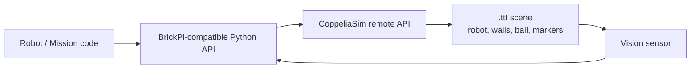

# Simulation process

The robot was developed alongside a **CoppeliaSim** model of the arena, and the same high-level control code was reused on both. This document explains how that worked, what it was useful for, and why the simulator files are not part of this repository.

## Why simulate?

A 2.8 m × 2.8 m arena (7 × 7 cells of 40 cm), a charged BrickPi, and a camera are not always available. Simulation made it possible to:

- iterate on the NF1 planner and the replanning logic without driving;
- test the odometry/kinematics sign conventions;
- tune the HSV ball thresholds against rendered frames;
- debug the marker-matching pipeline against known marker poses;
- rehearse the full phase sequence before a hardware session.

It is not a substitute for the real robot: wheel slip, floor friction, lighting, and camera latency only appear on hardware.

## The simulation stack used in the course



The scene contained a differential-drive robot (`CubeRob1`) with:

- left, right, and claw joints;
- a front proximity sensor used as the ultrasonic;
- a side proximity sensor for wall following;
- a vision sensor used as the light sensor;
- a vision sensor used as the Pi camera.

Two course scenes were used at different stages (`p1.ttt` and `p2.ttt`), plus a reusable `RobotLego.ttm` robot model. The scene files are each about 5 MB.

A small Python bridge exposed the same methods as the BrickPi3 library:

| BrickPi3 call | Simulation mapping |
|---------------|--------------------|
| `set_motor_dps(port, dps)` | Set the corresponding joint target velocity |
| `get_motor_encoder(port)` | Read the joint position in degrees |
| `offset_motor_encoder(port, value)` | Shift the joint encoder |
| `set_sensor_type(port, type)` | Attach a proximity/vision sensor wrapper |
| `get_sensor(port)` | Read distance, light, or gyro |
| `reset_all()` | Stop the simulation |

The simulation exposed a camera wrapper over a CoppeliaSim vision sensor; on hardware the same frames come from OpenCV's `VideoCapture`.

## The code seam

The original `Robot.py` switched the BrickPi import between simulation and hardware:

```python
# simulation
import CoppeliaAPI.csimBrickpi as brickpi3

# real robot
import brickpi3
```

The final integration also had to change the motor-port mapping (`B`/`C`/`A` in the simulation vs `D`/`C`/`B` on the real robot). In this refactor both the import and the port map are configuration concerns, not code edits.

Everything else — odometry, NF1, waypoint control, vision — was shared. This is the same seam the refactored repository exposes through the `Hardware` protocol in `robot/hardware.py`.

## What the simulation was used for

| Area | Simulated check | Real-robot check |
|------|-----------------|------------------|
| Kinematics / odometry | Straight lines, in-place turns, arc integration | Encoder direction and wheel-radius calibration |
| NF1 planning | Full cost field, path, edge-removal replanning | Waypoint tracking and ultrasonic obstacle detection |
| Slalom | Segment timing and wall-alignment checkpoints | Floor friction and turning radius |
| Ball tracking | HSV ranges on rendered red ball | Lighting, reflections, gripper alignment |
| Marker recognition | ORB/RANSAC on rendered marker boards | Print quality, perspective, motion blur |
| Mission sequencing | Phase sequencing and transitions | Full run under competition conditions |

The simulation was especially useful for the **planner**: a blocked edge could be introduced on demand and the replanned route inspected immediately. It was less useful for the **gripper** and for **odometry drift**, which depend on contact and wheel slip.

## Sim-to-real gaps

| Simulated | Real robot |
|-----------|------------|
| Ideal wheel velocity tracking | Wheel slip, motor deadband, battery sag |
| Noise-free joint encoders | Encoder resolution and occasional I2C glitches |
| Ray-cast proximity sensor | Ultrasonic cone, specular reflections, 255 cm “no echo” |
| Perfect lighting | Shadows, reflections, auto-exposure |
| Instant camera frames | USB/Pi camera latency and rolling shutter |
| Kinematic gripper | Compliance, friction, ball deformation |

The control code therefore includes timeouts, median ultrasonic filtering, tolerance bands, and a stuck detector; these are the parts that make the transition from simulation to hardware tolerable.

## What is intentionally not included

The public repository does **not** contain:

| Asset | Approx. size | Why |
|-------|--------------|-----|
| `p1.ttt`, `p2.ttt` scenes | 5 MB each | Third-party/course scene files; binary format; not needed to read the code |
| `robot/RobotLego.ttm` | 111 KB | Scene model |
| `CoppeliaAPI/` bridge (`csimBrickpi.py`, `csimCamera.py`, `cfg.py`) | ~16 KB | Course-provided adapter tied to CoppeliaSim and the ZMQ remote API |
| Course PDFs, zips, example scripts | several MB | Not the project's own work; licensing and noise |

This keeps the repository small and focused on the robot's own algorithms. The simulation **process** is documented; the simulator **vendored code** is not.

## Reproducing the simulation

You need CoppeliaSim and a BrickPi-compatible adapter. The repository's `Hardware` protocol is deliberately small, so an adapter only needs these methods:

```python
from robot.config import ARENAS, DEFAULT_VISION_CONFIG
from robot.mission import Mission
from robot.robot import Robot


class CoppeliaHardware:
    def set_motor_dps(self, port, dps): ...
    def get_encoder(self, port): ...
    def reset_encoder(self, port): ...
    def set_sensor_type(self, port, sensor_type): ...
    def read_ultrasonic(self, port): ...
    def read_gyro(self, port): ...
    def read_light(self, port): ...
    def reset_all(self): ...


robot = Robot(CoppeliaHardware())
Mission(robot, ARENAS["a"], vision_config=DEFAULT_VISION_CONFIG).run()
```

The adapter maps the same port names used in `robot/config.py` (`C`/`D` drive, `B` gripper, `1` ultrasonic, `3` gyro, `4` light) to the simulated joints and sensors. The camera side can be a small wrapper with the same `read()`/`release()` methods as `cv2.VideoCapture`, or you can feed recorded frames into `BallTracker`/`MarkerFollower` directly.

> The `demo.py` script is **not** the CoppeliaSim simulation. It is a hardware-free visualization of the NF1 planner: it loads a map, computes the cost field, and draws the path. It is useful for reviewers who do not have a robot or a simulator.

## Reproducing the public checks

The checks that do not need CoppeliaSim or the robot are:

```bash
python -m unittest discover -s tests -v          # 20 tests
python demo.py --map maps/arena_a.txt --start 1 2 --goal 3 3
python tools/detect_markers.py \
  --image assets/samples/markers_test.jpg \
  --output docs/images/marker_detection.jpg
```

These validate the planner, the kinematics, and the two vision pipelines on recorded data. The full mission remains a hardware/simulator exercise.
